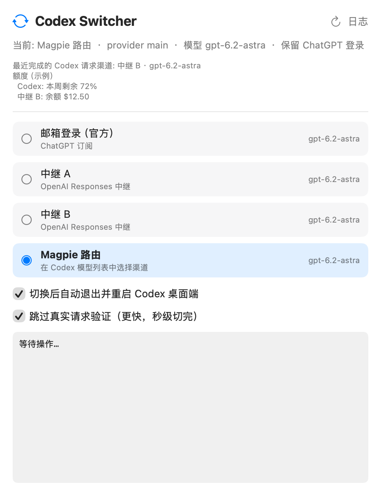

# Codex Switcher

Switch Codex on macOS between your ChatGPT account and API relays. The default configuration keeps `model_provider = "main"` so your chat history stays in one list.

[中文](README.md) · [Install](#install) · [Usage](#usage) · [Troubleshooting (Chinese)](docs/troubleshooting.md)



## Install

Requires macOS 13+, Python 3.11+, and Xcode Command Line Tools to build the app from source.

```bash
git clone https://github.com/Universeeeeeee/Codex-Switcher.git
cd Codex-Switcher
./install.sh
```

Open Codex Switcher from Applications or run `~/.codex-switcher/codex_switch.sh`. Prebuilt versions are available on [GitHub Releases](https://github.com/Universeeeeeee/Codex-Switcher/releases).

## Configure

1. Sign in once in Codex Desktop.
2. Edit `~/.codex-switcher/providers.json`. The official channel uses your Codex sign-in. For a relay, follow the [example configuration](providers.example.json) and set `id`, `baseUrl`, `apiKey`, and `model` with `responses` as the protocol.
3. Keep `providerId` set to `main` so switching channels keeps your chats in the same list.

Keep `providers.json` on your machine because it contains API keys.

## Usage

Select a channel in the Switcher window or use the command line.

```bash
~/.codex-switcher/codex_switch.sh official --restart
~/.codex-switcher/codex_switch.sh relay-a --dry-run
```

Replace `relay-a` with your configured channel ID. Use `--restart` to relaunch Codex Desktop and `--dry-run` to preview config changes.

### Magpie mode

Install [Magpie](https://github.com/yetone/magpie) and configure the relays required by Switcher to use Magpie routing. Select a relay by name in the Codex model menu. Switcher shows the channel used by the most recent completed request and any available quota data.

```bash
~/.codex-switcher/codex_switch.sh magpie --restart
~/.codex-switcher/codex_switch.sh magpie-status
~/.codex-switcher/codex_switch.sh magpie-off --restart
```

`magpie-off` restores the configuration used before Magpie mode. See [troubleshooting](docs/troubleshooting.md) for backups and other recovery options.

## Credits

- [yetone/magpie#994](https://github.com/yetone/magpie/issues/994) for the fixed-provider-id / keep-ChatGPT-login discussion
- [openai/codex](https://github.com/openai/codex) for the credential precedence (bearer token wins over the ChatGPT session)

## License

[MIT](LICENSE)
