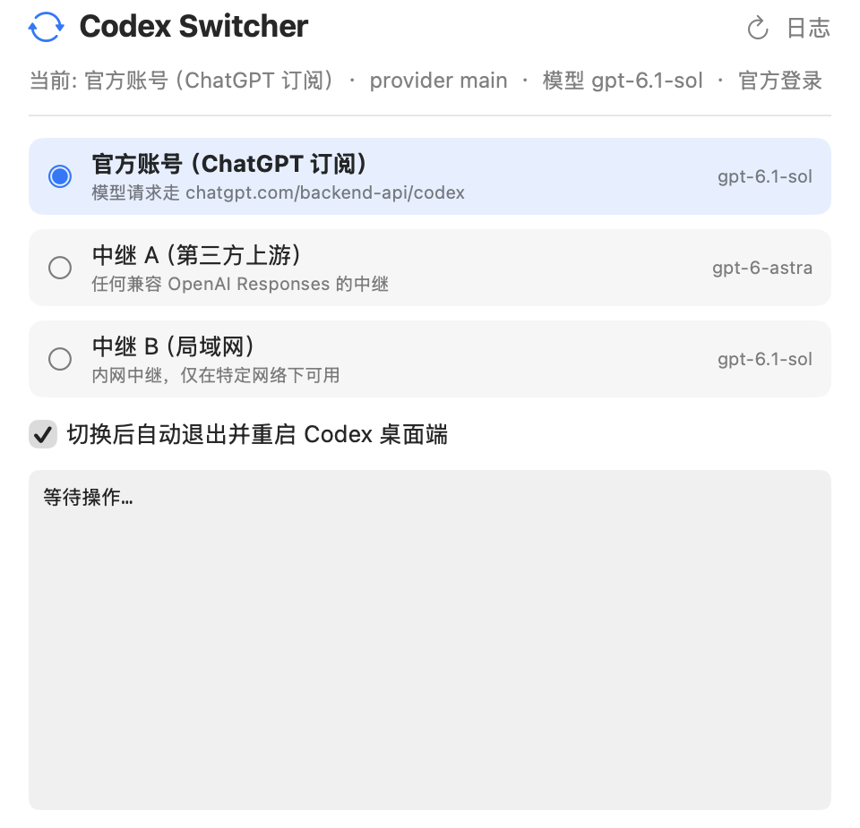

# Codex Switcher

> Switch Codex between the official backend and any number of relays — **without ever changing the `model_provider` id**, so your chat history always stays in one list.

macOS · one bash script + a ~250 KB native window · no gateway, no daemon · MIT

[中文说明](README.md) · [Why](#why-pick-it-three-reasons) · [Comparison](#comparison-magpie--cc-switch--this-project) · [Install](#install)



<sub>A switch is now 3 steps (check + backup → apply → verify + relaunch), usually 2–10 s. Clicking the channel you are already on returns immediately:</sub>

```text
▶ 1/3 检查 & 备份
  ✅ config.toml 可解析 · 当前 provider=main / auth=chatgpt · 会话 661 条
  ✅ 已备份 config/auth → ~/.codex-switcher/backups/20261020_144453-official

▶ 2/3 应用
  ✅ 登录态有效（token 剩余 10.0 天），无需刷新
  ✅ config.toml 已更新（官方后端 …/backend-api/codex · gpt-6.1-sol / high）
  ✅ 历史标签一致（661 条） · cc-switch 已同步

▶ 3/3 验证 & 重启
  ✅ 真实请求成功（模型回复 OK，6.8s）—— 该通道当前可用
  ✅ ChatGPT 已重启（2s）
═══════════════════════════════════════════════
 ✅ 已切换到「邮箱登录（官方）」· 用时 9s
```

Switching to the channel that is already active skips everything (backup, writes, verification, relaunch) and returns "nothing to switch" in about 0.1 s.text
▶ 4/9 生成 config.toml
  provider=main | model=gpt-6-astra | effort=high | 中继 https://<your relay> | 保留 ChatGPT 登录
  ✅ config.toml 已更新
  ✅ 已确认 provider 段存在（不会再出现 'Model provider not found'）

▶ 5/9 会话历史桶 -> main
  ✅ 标签已一致（647 条），无需改写        ← with a fixed id, nothing to rewrite from the 2nd switch on

▶ 7/9 端到端验证
  ✅ 真实请求成功（模型回复 OK）—— 该通道当前可用
```

---

## Why pick it: three reasons

1. **It fixes bucketing today.** magpie's plan is broader but still an open issue; cc-switch doesn't touch it. Here the provider id is fixed, plus an optional **one-time** history migration (`threads.model_provider` and `model_provider` / `model_provider_id` inside session files — including easily-missed files like `….jsonl_副本`).
2. **Zero always-on dependency.** No gateway, no daemon, no port. magpie is far more capable, but it must keep running — quit it and the agent loses its provider.
3. **It proves the switch worked, and repairs broken configs.** Each switch fires one minimal real request using Codex's own protocol (no full `codex exec` cold start: 6–10 s instead of 30–90 s); upstream quota exhaustion surfaces instead of a silent failure, and a channel verified in the last 2 minutes is not re-tested. Use `--verify-cli` if you want the old CLI-based check. Every run also asserts that the `[model_providers.*]` table referenced by `model_provider` exists — the exact cause of `Model provider not found`.

## Comparison: magpie / cc-switch / this project

| | **Codex Switcher** | [cc-switch](https://github.com/farion1231/cc-switch) | [magpie](https://github.com/yetone/magpie) |
|---|---|---|---|
| Scope | One job: switch Codex upstreams without splitting history | Provider config switcher for several CLIs | Model/provider/account manager for every agent |
| UI | Small native window | GUI | Menu bar + window + TUI + CLI |
| **History bucketing** | ✅ **never** (fixed provider id) | ❌ other bucket disappears¹ | ⚠️ splits into `openai` / `magpie` buckets; #994 accepted, **not shipped as of 2026-10-16** |
| Keeps ChatGPT sign-in | ✅ also on relays (apikey mode optional) | configurable | ✅ never touches it |
| **Verifies the switch actually works** | ✅ sends a real request every time (`codex exec --ephemeral`, nothing written) | ❌ | ⚠️ gateway health only, not Codex end-to-end |
| Repairs a half-written config | ✅ checks/rewrites the `[model_providers.*]` table on every run | ❌ | ✅ documented |
| Runtime dependency | **none** — Codex talks straight to the upstream | GUI app | **local gateway must stay running** (127.0.0.1:3425) |
| Size / auditable | ~450 lines bash + ~250 lines Swift, plain text | GUI | large project (plugins, routing, …) |

¹ Measured on macOS with the Codex desktop app: after switching providers with cc-switch, Codex's thread bucket labels did not follow, so only the bucket matching the new provider stayed visible (1 of 647 threads in our case). cc-switch manages `config.toml` / `auth.json`; thread labels are outside its scope.

### When to use something else

- Multi-agent, multi-account, quota-aware failover, models in Codex's own picker → **magpie**.
- Mostly Claude Code config switching → **cc-switch**.
- "Just don't scramble my Codex history" → this.

---

## The problem

Codex groups its thread history **by `model_provider`**, and the sidebar only lists the bucket of the provider currently in use. So every time you switch upstream (official ↔ relay, or relay A → relay B):

- the conversations from the other side **appear to vanish** (they're still there, in another bucket);
- history imported from other tools sits under old ids like `custom` / `main` and is invisible too;
- if the config gets half-written — `model_provider = "xxx"` with no `[model_providers.xxx]` table — Codex refuses to open the thread at all:

  > ChatGPT 无法加载 config.toml … Model provider `custom` not found

## The fix

**Keep one provider id forever; only change what it points at.**

```toml
model_provider = "main"            # never changes (providers.json → providerId)

[model_providers.main]             # this table always exists; switching rewrites it
name = "main"
wire_api = "responses"
requires_openai_auth = true        # Codex keeps its ChatGPT sign-in
base_url = "https://…"             # official backend, or a relay
experimental_bearer_token = "…"    # relays only
```

- **Official**: `base_url = https://chatgpt.com/backend-api/codex`, no token.
- **Relay**: `base_url = <your relay>` plus `experimental_bearer_token`.

With `requires_openai_auth = true` the app stays signed in to ChatGPT (many app features need it) while model requests carry the relay key to `base_url`. This is the "bound OAuth" shape discussed in [yetone/magpie#994](https://github.com/yetone/magpie/issues/994); this repo makes it a ready-to-use tool.

Because the provider id never changes, Codex's thread list is one list forever — no per-switch migration, no second bucket.

## Install

```bash
git clone https://github.com/Universeeeeeee/Codex-Switcher.git
cd Codex-Switcher
./install.sh
```

This installs the script to `~/.codex-switcher/`, creates `providers.json` from the template (mode 0600) and builds/installs `CodexSwitcher.app`.

## Usage

```bash
~/.codex-switcher/codex_switch.sh relay-a              # switch
~/.codex-switcher/codex_switch.sh official --restart   # switch and relaunch Codex
~/.codex-switcher/codex_switch.sh official --no-verify # switch without the real request (fastest)
~/.codex-switcher/codex_switch.sh relay-a --dry-run    # show what would change
```

Sign in to ChatGPT in the Codex app once; the tool snapshots that sign-in on your first switch, after which you can move freely between channels.

Flags: `--dry-run`, `--no-history`, `--no-verify`, `--verify-cli`, `--no-ccswitch`, `--legacy-ids`. The app also has a "skip the real request" checkbox.

## Measured evidence (macOS 26, codex-cli 0.163.0-alpha.10.2)

| Check | Method | Result |
|---|---|---|
| Relay really is used, official account untouched | fixed id + `requires_openai_auth = true` + bearer token; compare the relay's own usage API before/after | `gpt-6-astra` requests **315 → 316**, while `auth.json` stayed `auth_mode: "chatgpt"` |
| Official works under the same id | `base_url = https://chatgpt.com/backend-api/codex`, no token | OK under the same provider id; response showed `cached_input_tokens: 5632` |
| No more label rewriting | official ↔ relay round trip | from the second switch on: **"labels already consistent (647), nothing to rewrite"** |
| Config self-repair | hand-broke the config (`model_provider = "custom"`, no such table) | table rewritten on the next switch; no more `Model provider not found` |

## Safety

- Backs up config / auth before every switch; the state DB is only backed up when history labels actually need migrating (last 15 kept) under `~/.codex-switcher/backups/`
- `--dry-run` writes nothing; assertions cover `model_provider`, `base_url` and the token; switching to the active channel writes nothing at all
- History migration only rewrites tag fields — never message content or model fields

## Limitations

- macOS + Codex only (SwiftUI GUI needs Xcode Command Line Tools)
- No quota-aware failover — it tells you when a channel is exhausted, it doesn't hop for you
- Does not inject relay models into Codex's own model picker; set the model per channel in `providers.json`
- `https://chatgpt.com/backend-api/codex` is extracted from the CLI binary (undocumented, may change); the fast verifier uses the same undocumented endpoint — use `--verify-cli` to cross-check or `--no-verify` to skip if it ever misbehaves
- Personal tool, no maintenance promise

## Credits

- [yetone/magpie#994](https://github.com/yetone/magpie/issues/994) for the fixed-provider-id / keep-ChatGPT-login discussion
- [openai/codex](https://github.com/openai/codex) for the credential precedence (bearer token wins over the ChatGPT session)

## License

MIT
