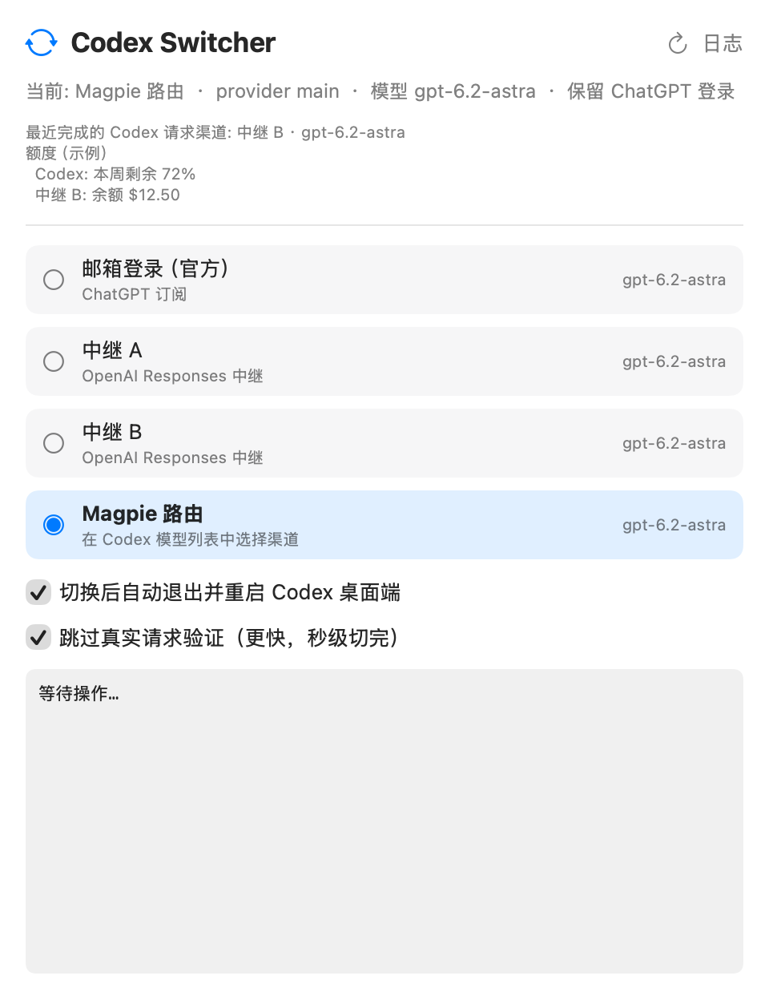
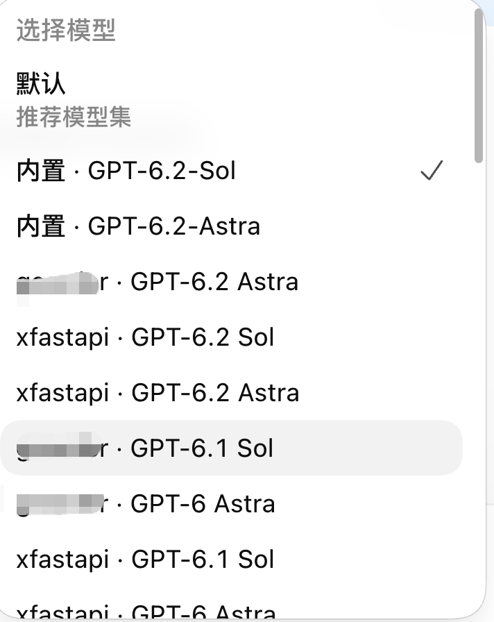

# Codex Switcher

在 macOS 上一键切换 Codex 的官方账号和 API 中继。默认固定 `model_provider = "main"`，让历史会话留在同一个列表里。 在本机保持邮箱登录 ChatGPT，切换到使用其他额度的渠道后仍可使用 Dot。

[English](README.en.md) · [安装](#安装) · [使用](#使用) · [排错](docs/troubleshooting.md)



## 安装

需要 macOS 13+、Python 3.11+ 和 Xcode Command Line Tools（用于从源码编译窗口）。

```bash
git clone https://github.com/Universeeeeeee/Codex-Switcher.git
cd Codex-Switcher
./install.sh
```

安装后可以在「应用程序」里打开 Codex Switcher，也可以直接用 `~/.codex-switcher/codex_switch.sh`。预编译版本见 [GitHub Releases](https://github.com/Universeeeeeee/Codex-Switcher/releases)。

## 配置

1. 在 Codex 桌面端登录 ChatGPT 一次。
2. 编辑 `~/.codex-switcher/providers.json`。官方渠道使用 Codex 登录态。中继渠道按 [配置示例](providers.example.json) 填写 `id`、`baseUrl`、`apiKey` 和 `model`，协议使用 `responses`。
3. 保持 `providerId` 为 `main`，避免因切换而产生新的会话桶。

`providers.json` 含 API Key，请保存在本机。

## 使用

在 Switcher 窗口点选一个渠道，或使用命令行。

```bash
~/.codex-switcher/codex_switch.sh official --restart
~/.codex-switcher/codex_switch.sh relay-a --dry-run
```

将 `relay-a` 换成你配置中的渠道 ID。`--restart` 会重启 Codex 桌面端，`--dry-run` 可预览配置变更。

### Magpie 模式

安装 [Magpie](https://github.com/yetone/magpie) 并配置 Switcher 所需的中继后，可以在 Switcher 中选「Magpie 路由」。在 Codex 模型菜单里，带中继名称的条目使用对应渠道。Switcher 的状态区显示最近完成的请求渠道与可查到的额度。



```bash
~/.codex-switcher/codex_switch.sh magpie --restart
~/.codex-switcher/codex_switch.sh magpie-status
~/.codex-switcher/codex_switch.sh magpie-off --restart
```

`magpie-off` 恢复启用网关前的配置。直连切换的备份和其他恢复方式见 [排错文档](docs/troubleshooting.md)。

## 致谢

- [yetone/magpie#994](https://github.com/yetone/magpie/issues/994) —— 「固定 provider id + 保留 ChatGPT 登录」的讨论与 `requires_openai_auth` 用法的来源
- [openai/codex](https://github.com/openai/codex) —— `resolve_provider_auth` 的凭据优先级（bearer token 优先于 ChatGPT session）

## 许可证

[MIT](LICENSE)
